<!-- Aazim Ameen — GitHub profile.
     Every block below is an animated SVG card in cards/, redrawn daily by
     .github/workflows/render-cards.yml from real contribution data.
     Method: https://www.avivashishta.com/blog/github-profile-readme-animated-svg-cards -->

These cards are animated SVGs, redrawn every morning by a GitHub Action from my real contribution data. Design inspired by <a href="https://www.avivashishta.com/blog/github-profile-readme-animated-svg-cards">Avi Vashishta's write-up</a>.

